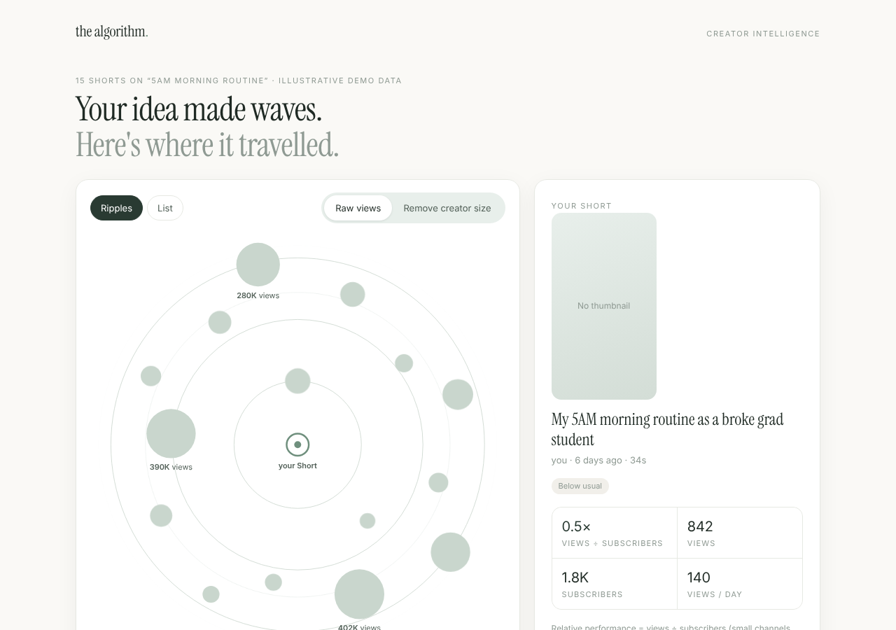
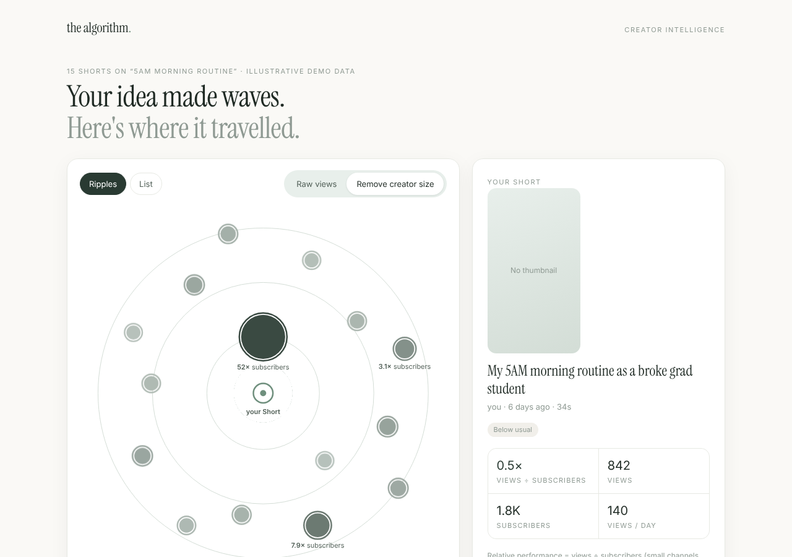

# wave.

**Same idea. Different outcomes.**

Paste a YouTube Short and Wave finds other Shorts on the same trend or idea. They ripple out from
yours on a map, sized by views. One toggle removes creator size, so you see which videos actually beat
their creator's usual reach. You.com explains, with sources, why the trend is moving right now, and you
leave with one concrete experiment for your next post.

> The algorithm doesn't always get you. But now you can get it.

Built at **Creator Economy Hack NYC** (You.com × localhost:nyc × GenZtea).

**Live demo:** [TBD: live link]  ·  **Pitch script:** [docs/PITCH.md](docs/PITCH.md)  ·  **Demo post:** [docs/POST.md](docs/POST.md)

## The ripple map

| Raw views | Remove creator size |
| --- | --- |
|  |  |

Screen recording of the toggle: [docs/screenshots/ripple-toggle-demo.mp4](docs/screenshots/ripple-toggle-demo.mp4)

Screenshots use the demo data (`USE_MOCK=1`), which is fictional.

## How it works
1. **Drop** a YouTube Short link.
2. **Find** similar Shorts with the YouTube Data API and You.com search.
3. **Normalize**: outperformance = views ÷ subscribers (floored at 100). Hidden counts show as "hidden".
4. **Explain**: the verdict separates what we observed, what might explain it, and what public data can't tell us.

## How it uses You.com
- **Web Search API** finds recent coverage of the idea. We keep only results that come back with real URLs.
- **Research API** writes a 2–3 sentence summary of why the idea is moving now, with cited sources.
- **Research API** (second call) turns the computed numbers for the top and bottom five Shorts into the breakout
  patterns, timing and unknowns. It sees only those numbers, and falls back to a numbers-only verdict on any failure
  or after 12 seconds.

Code: [`lib/youcom.ts`](lib/youcom.ts). Try it with `npx tsx scripts/try-youcom.ts`.

## Run locally
```bash
npm install
cp .env.example .env.local   # USE_MOCK=1 runs on demo data, no keys needed
npm run dev
```

## Team
- Sachi Singh — product, UI, end-to-end flow
- Melody — backend and data pipeline
- Khyati — pitch, demo and frontend components
